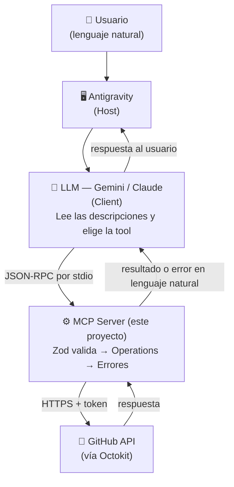

# 🤖 GitHub MCP Server — AutomateHub

> MCP Server en Node.js + TypeScript que permite a un **agente de IA** (Gemini, Claude u otro LLM) automatizar operaciones en **GitHub** usando **lenguaje natural**, a través del **Model Context Protocol (MCP)**.

Proyecto Integrador 5 — Especialización Backend (Soy Henry).

---

## 📑 Índice

1. [¿Qué hace?](#-qué-hace)
2. [Casos de uso](#-casos-de-uso)
3. [Arquitectura](#-arquitectura)
4. [Requisitos](#-requisitos)
5. [Instalación paso a paso](#-instalación-paso-a-paso)
6. [Configuración](#-configuración)
7. [Documentación de las tools](#-documentación-de-las-tools)
8. [Ejemplos de uso](#-ejemplos-de-uso)
9. [Manejo de errores](#-manejo-de-errores)
10. [Tests](#-tests)
11. [Estructura del proyecto](#-estructura-del-proyecto)
12. [Decisiones técnicas](#-decisiones-técnicas)
13. [Troubleshooting](#-troubleshooting)
14. [Licencia](#-licencia)

---

## 🎯 ¿Qué hace?

Este servidor expone **10 herramientas (tools)** que un agente de IA puede usar para trabajar en GitHub. El usuario escribe en lenguaje natural, por ejemplo:

> *"Creá un repo llamado mi-api y abrile un issue para configurar el CI"*

y el agente decide **qué tools usar** y **con qué parámetros**, las ejecuta y responde con el resultado.

| Tool | Qué hace | Tipo |
|---|---|---|
| `create_repository` | Crea un repositorio nuevo | Obligatoria |
| `create_issue` | Abre un issue con título y descripción | Obligatoria |
| `list_repositories` | Lista los repositorios del usuario | Obligatoria |
| `create_commit` | Crea o modifica un archivo con un commit | Obligatoria |
| `list_issues` | Lista los issues de un repositorio | Obligatoria |
| `create_branch` | Crea una branch nueva | Extra |
| `close_issue` | Cierra un issue (con comentario opcional) | Extra |
| `add_comment_to_issue` | Comenta en un issue | Extra |
| `list_commits` | Lista los commits recientes | Extra |
| `health_check` | Verifica conexión, scopes del token y rate limit | Extra |

---

## 💡 Casos de uso

- **Arrancar proyectos rápido:** crear un repo con README y su primer issue en una sola frase.
- **Gestionar tareas sin salir del IDE:** listar, crear, comentar y cerrar issues hablando con el agente.
- **Documentar:** pedirle al agente que escriba y suba un archivo (`docs/setup.md`, `CHANGELOG.md`, etc.).
- **Revisar actividad:** "¿qué cambios se hicieron últimamente en mi-api?"
- **Diagnosticar:** "¿por qué no puedo crear issues?" → el agente usa `health_check` y revisa los permisos del token.

---

## 🏗️ Arquitectura



**Flujo de una solicitud** (ejemplo: *"abrí un issue en demo que diga 'arreglar login'"*):

1. **Antigravity (Host)** recibe el mensaje y lo pasa al LLM junto con la lista de tools disponibles.
2. **El LLM (Client)** lee las descripciones, elige `create_issue` y arma los parámetros: `{ "repo": "demo", "title": "Arreglar login" }`.
3. **El MCP Server** recibe la llamada por **stdio** (JSON-RPC), **valida** los datos con Zod y ejecuta la operación con Octokit (con reintentos si hace falta).
4. **GitHub API** crea el issue y responde.
5. El servidor devuelve un **resumen claro** (o un **error en lenguaje natural**), y el LLM se lo comunica al usuario.

### Capas internas del servidor

```
server.ts ──► tools/ ──► schemas/ (validación Zod)
                 │
                 └──► github/operations.ts ──► github/client.ts (Octokit)
                          │
                          ├──► utils/retry.ts   (exponential backoff)
                          ├──► errors/          (traducción a lenguaje natural)
                          └──► utils/logging.ts (logs a stderr, sin datos sensibles)
```

---

## 📋 Requisitos

| Requisito | Versión |
|---|---|
| Node.js | **18 o superior** (probado con v24) |
| npm | 9 o superior |
| Cuenta de GitHub | con un Personal Access Token (classic) |
| Antigravity | IDE/Host para conectar el servidor con el LLM |
| Git | para clonar el repositorio |

---

## 🚀 Instalación paso a paso

**1. Clonar el repositorio**

```bash
git clone https://github.com/gnvidia06-ux/github-mcp-server.git
cd github-mcp-server
```

**2. Instalar dependencias**

```bash
npm install
```

**3. Crear el archivo `.env`** a partir del ejemplo

```bash
# macOS / Linux
cp .env.example .env

# Windows (PowerShell)
Copy-Item .env.example .env
```

**4. Completar el token** en `.env` (ver la [sección de configuración](#1-obtener-el-github-personal-access-token)).

**5. Compilar TypeScript**

```bash
npm run build
```

Esto genera la carpeta `dist/` con `dist/server.js`, que es lo que ejecuta el host.

**6. Verificar que todo funciona**

```bash
npm test            # corre los tests unitarios
npm run inspector   # abre MCP Inspector para probar las tools
```

---

## ⚙️ Configuración

### 1. Obtener el GitHub Personal Access Token

1. Entrá a GitHub → foto de perfil → **Settings**.
2. Menú izquierdo, al final → **Developer settings**.
3. **Personal access tokens** → **Tokens (classic)** → **Generate new token (classic)**.
4. Completá:
   - **Note:** `mcp-server`
   - **Expiration:** 30 o 60 días (recomendado: que expire).
   - **Scopes:** marcá los tres de la tabla de abajo.
5. **Generate token** y copialo (GitHub lo muestra **una sola vez**).

### 2. Scopes que necesita el token

| Scope | Para qué se usa |
|---|---|
| `repo` | Crear repositorios, issues, commits, branches y leer repos privados |
| `user` | Obtener el usuario autenticado (owner por defecto) |
| `admin:org` | Operar sobre repositorios de organizaciones |

> 💡 Podés verificar los scopes en cualquier momento con la tool `health_check`.

### 3. Configurar el `.env`

```env
# Token personal de GitHub (classic) con scopes: repo, user, admin:org
GITHUB_TOKEN=ghp_tuTokenAca

# Nivel de logs: debug | info | warn | error
LOG_LEVEL=info
```

> ⚠️ **Nunca subas el `.env` a GitHub.** Ya está incluido en `.gitignore`. Si el token se filtra, **revocalo inmediatamente** en GitHub y generá uno nuevo.

### 4. Configurar el MCP Server en Antigravity

1. Abrí el archivo de configuración global de MCP de Antigravity:
   - **Desde la app:** panel del agente → `…` → **MCP Servers** → **Manage MCP Servers** → **View raw config**.
   - **O directamente:** `~/.gemini/config/mcp_config.json`
     (en Windows: `C:\Users\TU_USUARIO\.gemini\config\mcp_config.json`).

2. Agregá el servidor (reemplazá la ruta y el token):

```json
{
  "mcpServers": {
    "github-automatehub": {
      "command": "node",
      "args": ["C:/ruta/absoluta/a/github-mcp-server/dist/server.js"],
      "env": {
        "GITHUB_TOKEN": "ghp_tuTokenAca",
        "LOG_LEVEL": "info"
      }
    }
  }
}
```

> 📌 En Windows usá **barras normales `/`** en la ruta (o dobles `\\`). Una barra simple `\` rompe el JSON.
>
> 📌 Este archivo es **global** (está en tu usuario, fuera del proyecto), así que el token **no se sube al repositorio**.

3. **Reiniciá Antigravity.**
4. Abrí una conversación nueva y probá: *"¿Qué repositorios tengo en GitHub?"*
5. La primera vez que el agente use una tool, Antigravity pedirá **permiso**. Elegí *"Yes, and always allow in this conversation"*.

### 5. (Opcional) Probar con MCP Inspector

```bash
npm run build
npm run inspector
```

Se abre en el navegador. Activá la conexión, entrá a **Tools** y ejecutá cualquier tool completando sus campos.

---

## 🛠️ Documentación de las tools

> En todas las tools que reciben `owner`: **si se omite, se usa el usuario dueño del token.**

### `create_repository`

Crea un repositorio **nuevo** en la cuenta del usuario autenticado.

| Parámetro | Tipo | Requerido | Descripción |
|---|---|---|---|
| `name` | string | ✅ | 3–100 caracteres: letras, números, `-`, `_` y `.`. Sin espacios. No puede terminar en `.git` |
| `description` | string | ❌ | Máximo 350 caracteres |
| `private` | boolean | ❌ | `false` por defecto (público) |
| `autoInit` | boolean | ❌ | `true` por defecto (crea un README inicial) |

**Prompt de ejemplo:**
> *"Creá un repositorio privado llamado api-turnos con la descripción 'API para gestión de turnos'"*

---

### `create_issue`

Abre un issue **nuevo** en un repositorio.

| Parámetro | Tipo | Requerido | Descripción |
|---|---|---|---|
| `owner` | string | ❌ | Usuario u organización dueña del repo |
| `repo` | string | ✅ | Nombre del repositorio |
| `title` | string | ✅ | 1–256 caracteres |
| `body` | string | ❌ | Descripción (acepta Markdown) |
| `labels` | string[] | ❌ | Etiquetas existentes. Ej: `["bug"]` |

**Prompt de ejemplo:**
> *"Abrí un issue en api-turnos con el título 'Agregar validación de fechas' y explicá que hoy se aceptan fechas pasadas"*

---

### `list_repositories`

Lista los repositorios del usuario autenticado (propios y de organizaciones). Resultados **cacheados 5 minutos**.

| Parámetro | Tipo | Requerido | Descripción |
|---|---|---|---|
| `visibility` | `"all"` \| `"public"` \| `"private"` | ❌ | `"all"` por defecto |
| `sort` | `"created"` \| `"updated"` \| `"pushed"` \| `"full_name"` | ❌ | `"updated"` por defecto |
| `perPage` | number | ❌ | 1–100, `30` por defecto |

**Prompt de ejemplo:**
> *"Mostrame mis 5 repositorios privados actualizados más recientemente"*

---

### `create_commit`

Crea un archivo **nuevo** o **reemplaza** el contenido de uno existente, haciendo un commit.

| Parámetro | Tipo | Requerido | Descripción |
|---|---|---|---|
| `owner` | string | ❌ | Usuario u organización |
| `repo` | string | ✅ | Nombre del repositorio |
| `path` | string | ✅ | Ruta relativa (ej: `docs/setup.md`). Sin `/` inicial ni `..` |
| `content` | string | ✅ | Contenido completo del archivo |
| `message` | string | ✅ | Mensaje del commit (1–500 caracteres) |
| `branch` | string | ❌ | Branch destino (por defecto, la principal) |

**Prompt de ejemplo:**
> *"En api-turnos, creá el archivo docs/setup.md con instrucciones básicas de instalación usando npm, y commitealo con el mensaje 'docs: agrega guía de setup'"*

---

### `list_issues`

Lista los issues de un repositorio (**no** incluye pull requests).

| Parámetro | Tipo | Requerido | Descripción |
|---|---|---|---|
| `owner` | string | ❌ | Usuario u organización |
| `repo` | string | ✅ | Nombre del repositorio |
| `state` | `"open"` \| `"closed"` \| `"all"` | ❌ | `"open"` por defecto |
| `perPage` | number | ❌ | 1–100, `30` por defecto |

**Prompt de ejemplo:**
> *"¿Qué issues abiertos tiene api-turnos?"*

---

### `create_branch` *(extra)*

| Parámetro | Tipo | Requerido | Descripción |
|---|---|---|---|
| `owner` | string | ❌ | Usuario u organización |
| `repo` | string | ✅ | Nombre del repositorio |
| `branch` | string | ✅ | Nombre de la nueva branch (ej: `feature/login`) |
| `fromBranch` | string | ❌ | Branch base (por defecto, la principal) |

**Prompt de ejemplo:**
> *"Creá una branch feature/validaciones en api-turnos"*

---

### `close_issue` *(extra)*

| Parámetro | Tipo | Requerido | Descripción |
|---|---|---|---|
| `owner` | string | ❌ | Usuario u organización |
| `repo` | string | ✅ | Nombre del repositorio |
| `issueNumber` | number | ✅ | Número del issue (entero positivo) |
| `comment` | string | ❌ | Comentario a dejar antes de cerrar |

**Prompt de ejemplo:**
> *"Cerrá el issue #3 de api-turnos con el comentario 'Resuelto en el último commit'"*

---

### `add_comment_to_issue` *(extra)*

| Parámetro | Tipo | Requerido | Descripción |
|---|---|---|---|
| `owner` | string | ❌ | Usuario u organización |
| `repo` | string | ✅ | Nombre del repositorio |
| `issueNumber` | number | ✅ | Número del issue |
| `body` | string | ✅ | Texto del comentario (acepta Markdown) |

**Prompt de ejemplo:**
> *"Comentá en el issue #2 de api-turnos que ya estoy trabajando en eso"*

---

### `list_commits` *(extra)*

| Parámetro | Tipo | Requerido | Descripción |
|---|---|---|---|
| `owner` | string | ❌ | Usuario u organización |
| `repo` | string | ✅ | Nombre del repositorio |
| `branch` | string | ❌ | Branch (por defecto, la principal) |
| `perPage` | number | ❌ | 1–100, `30` por defecto |

**Prompt de ejemplo:**
> *"¿Cuáles fueron los últimos 5 commits de api-turnos?"*

---

### `health_check` *(extra)*

Sin parámetros. Devuelve el usuario autenticado, los scopes del token (y los que faltan), el rate limit restante y **métricas de uso** de cada tool.

**Prompt de ejemplo:**
> *"¿Funciona la conexión con GitHub? ¿Qué permisos tiene mi token?"*

---

### ✍️ Tips para prompts efectivos

- **Nombrá el repositorio** exactamente como está en GitHub.
- Para issues existentes, **mencioná el número** (`#3`). Si no lo sabés, pedí primero la lista.
- Podés **encadenar acciones** en una sola frase: el agente usará varias tools seguidas.
- Si el repo es de una organización, **mencioná la organización**: *"en la org acme, repo web..."*

---

## 🎬 Ejemplos de uso

**Flujo completo de un proyecto nuevo** (usa 5 tools distintas):

```
👤 Creá un repo público llamado demo-agente con la descripción "Demo de MCP"
🤖 [create_repository] Repositorio gnvidia06-ux/demo-agente creado como público.

👤 Agregale un archivo TODO.md con una lista de 3 tareas para una API REST
🤖 [create_commit] Archivo "TODO.md" creado con el commit a1b2c3d.

👤 Creá un issue por cada tarea del TODO
🤖 [create_issue x3] Issues #1, #2 y #3 creados.

👤 Creá una branch feature/auth para la primera tarea
🤖 [create_branch] Branch "feature/auth" creada a partir de "main".

👤 ¿Qué issues abiertos quedan?
🤖 [list_issues] Se encontraron 3 issues abiertos en demo-agente: ...

👤 Cerrá el #1 diciendo que ya se terminó
🤖 [close_issue] Issue #1 cerrado.

👤 Mostrame los últimos commits
🤖 [list_commits] Últimos 2 commits de demo-agente: ...
```

**Ejemplo de error manejado:**

```
👤 Mostrame los issues del repo repo-fantasma-123
🤖 No se pudo encontrar el repositorio gnvidia06-ux/repo-fantasma-123.
   Verificá que el nombre esté bien escrito.
```

---

## 🚨 Manejo de errores

Los errores técnicos se **transforman en mensajes en lenguaje natural** que el LLM puede comunicar al usuario. Nunca se devuelven stack traces.

| Tipo | Cuándo ocurre | Mensaje (ejemplo) | ¿Reintenta? |
|---|---|---|---|
| `ValidationError` | Input inválido (Zod) | *"name: El nombre del repositorio debe tener al menos 3 caracteres."* | No |
| `AuthenticationError` | 401, 403 o falta el token | *"El token de GitHub es inválido o expiró..."* | No |
| `GitHubAPIError` 404 | Recurso inexistente | *"El repositorio X no fue encontrado. Verifica el nombre e intenta de nuevo."* | No |
| `GitHubAPIError` 422 | Datos rechazados / ya existe | *"Ya existe un repositorio llamado X..."* | No |
| `GitHubAPIError` rate limit | 403/429 por límite de API | *"Se alcanzó el límite de solicitudes de GitHub..."* | Sí, con backoff* |
| `GitHubAPIError` 5xx | Falla temporal de GitHub | *"GitHub está teniendo problemas temporales..."* | Sí, con backoff |
| `NetworkError` | Sin internet, DNS, timeout | *"No se pudo conectar con GitHub..."* | Sí, con backoff |

**Retry con exponential backoff:** espera 0,5 s → 1 s → 2 s (máximo 3 reintentos) en lugar de reintentar inmediatamente.
\* Si GitHub pide esperar **más de 8 segundos** (por ejemplo, un rate limit que se reinicia en una hora), **no** se reintenta: se devuelve el mensaje al usuario para no bloquear al agente.

**Logging:** todos los logs se escriben en **stderr** en formato JSON con niveles (`debug`, `info`, `warn`, `error`). Los tokens (`ghp_...`, `github_pat_...`) y los campos sensibles se reemplazan por `[REDACTED]`.

---

## 🧪 Tests

```bash
npm test              # ejecuta todos los tests una vez
npm run test:watch    # modo watch (re-ejecuta al guardar)
```

**38 tests unitarios** con Vitest, en 3 archivos:

| Archivo | Qué verifica |
|---|---|
| `tests/tools.test.ts` | Schemas de Zod (inputs válidos pasan, inválidos fallan con el mensaje correcto) y el helper común de las tools |
| `tests/github.test.ts` | Operaciones de GitHub con **Octokit mockeado** (`vi.mock`): parámetros enviados, caché, creación vs. actualización de archivos, 404, 401 y rate limit |
| `tests/errors.test.ts` | Transformación de errores a lenguaje natural, retry con backoff, ocultamiento de tokens en logs y validación del token |

> Los tests **no llaman a la API real de GitHub**: son rápidos (menos de 1 segundo), determinísticos y no crean nada en tu cuenta.

---

## 📁 Estructura del proyecto

```
github-mcp-server/
├── src/
│   ├── server.ts                 # Entry point: crea el server MCP y conecta por stdio
│   ├── types.ts                  # Tipos compartidos de las respuestas
│   ├── tools/
│   │   ├── index.ts              # Registra todas las tools
│   │   ├── helpers.ts            # Lógica común: validar → ejecutar → responder + métricas
│   │   ├── create-repository.ts
│   │   ├── create-issue.ts
│   │   ├── list-repositories.ts
│   │   ├── create-commit.ts
│   │   ├── list-issues.ts
│   │   └── extra-tools.ts        # create_branch, close_issue, add_comment, list_commits, health_check
│   ├── schemas/
│   │   └── index.ts              # Schemas de Zod de cada tool + validateInput
│   ├── github/
│   │   ├── client.ts             # Configuración de Octokit (token desde env)
│   │   └── operations.ts         # Llamadas a la API de GitHub
│   ├── errors/
│   │   └── index.ts              # Errores custom + traducción a lenguaje natural
│   └── utils/
│       ├── logging.ts            # Logger estructurado a stderr con redacción de secretos
│       └── retry.ts              # Exponential backoff
├── tests/
│   ├── tools.test.ts
│   ├── github.test.ts
│   └── errors.test.ts
├── .env.example
├── .gitignore
├── package.json
├── tsconfig.json
├── vitest.config.ts
├── LICENSE
└── README.md
```

### Scripts disponibles

| Script | Qué hace |
|---|---|
| `npm run build` | Compila TypeScript a `dist/` |
| `npm start` | Ejecuta el servidor compilado |
| `npm run dev` | Ejecuta el servidor en desarrollo con `tsx` (sin compilar) |
| `npm test` | Corre los tests con Vitest |
| `npm run test:watch` | Tests en modo watch |
| `npm run lint` | Chequeo de tipos con TypeScript (`tsc --noEmit`) |
| `npm run inspector` | Abre MCP Inspector conectado al servidor |

---

## 🧭 Decisiones técnicas

- **Separación `client.ts` / `operations.ts`:** el cliente de Octokit está aislado, lo que permite **mockearlo** en los tests sin tocar la lógica de negocio.
- **Descripciones de tools orientadas al LLM:** cada descripción dice **cuándo usar** la tool y **cuándo no** (y cuál usar en su lugar). Es lo que permite que el agente elija bien.
- **Doble rol de Zod:** valida antes de llamar a GitHub (ahorra requests y da mejores mensajes) y genera el esquema que el LLM lee para saber qué parámetros enviar.
- **`owner` opcional:** si no se indica, se usa el dueño del token. Simplifica los prompts ("creá un issue en mi repo X").
- **stdio en lugar de HTTP:** el host lanza el servidor como proceso local y se comunican por stdin/stdout. No hay puertos abiertos ni servidor expuesto en la red, y el token nunca sale de la máquina más que hacia GitHub.
- **Logs solo a stderr:** stdout está reservado para el protocolo JSON-RPC. Un `console.log` rompería la comunicación.
- **`dotenv` con `quiet: true`:** evita que dotenv escriba mensajes en stdout.
- **Respuestas resumidas:** se devuelve una frase en lenguaje natural más un JSON con solo los campos útiles, en lugar de la respuesta completa de GitHub (que es enorme y gasta contexto del LLM).

---

## 🔧 Troubleshooting

| Problema | Causa probable | Solución |
|---|---|---|
| El agente no ve las tools | El host no cargó el servidor | Verificá la ruta absoluta a `dist/server.js` en `mcp_config.json`, corré `npm run build` y **reiniciá Antigravity** |
| `Cannot find module .../dist/server.js` | No se compiló o la ruta está mal | `npm run build` y revisá la ruta (usá `/` en Windows) |
| *"No se encontró GITHUB_TOKEN"* | Falta la variable de entorno | Agregala en `env` dentro de `mcp_config.json` (o en `.env` si usás Inspector) |
| *"El token de GitHub es inválido o expiró"* (401) | Token vencido, revocado o mal copiado | Generá un token nuevo y actualizalo |
| *"No tenés permisos..."* (403) | Al token le faltan scopes | Usá `health_check` para ver qué falta y regenerá el token con `repo`, `user` y `admin:org` |
| *"El repositorio X no fue encontrado"* | Nombre mal escrito o repo de otro owner | Pedí `list_repositories` para ver el nombre exacto, o indicá el `owner` |
| *"Hay un conflicto... puede estar vacío"* (409) | Repo sin commits | Crealo con `autoInit: true` (por defecto) |
| *"Se alcanzó el límite de solicitudes"* | Rate limit de GitHub (5000/hora) | Esperá al reinicio (lo indica `health_check`) |
| Error `process` / tipos de Node al compilar | Faltan los tipos de Node | Verificá `"types": ["node"]` en `tsconfig.json` y que esté instalado `@types/node` |
| El JSON de `mcp_config.json` no carga | Sintaxis inválida | Revisá comas y comillas; en Windows no uses `\` simple en rutas |
| Inspector se conecta pero las tools fallan | El `.env` no está en la raíz | El `.env` debe estar junto a `package.json` |

---

## 🔐 Seguridad

- El token se lee **solo** desde variables de entorno. Nunca está en el código.
- `.env` está en `.gitignore`; el repositorio incluye solo `.env.example` sin valores reales.
- Los logs ocultan tokens y campos sensibles (`[REDACTED]`).
- Antigravity pide **aprobación del usuario** antes de ejecutar cada tool (*human in the loop*).
- Si un token se expone: **revocalo inmediatamente** en GitHub → Settings → Developer settings → Tokens.

---

## 📄 Licencia

Distribuido bajo la licencia **MIT**. Ver el archivo [LICENSE](./LICENSE).

---

## 👤 Autor

**Agustín Vásquez** — [@gnvidia06-ux](https://github.com/gnvidia06-ux)

Proyecto Integrador 5 · Especialización Backend · Soy Henry